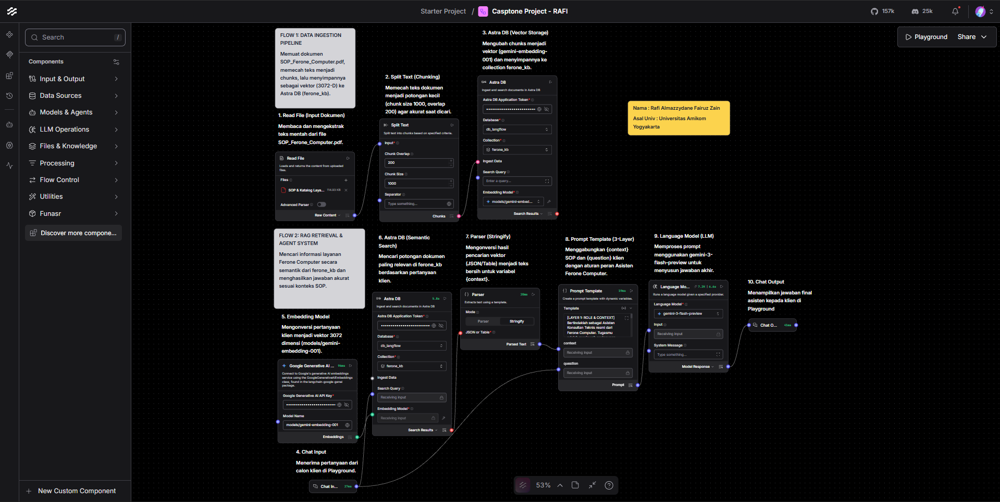
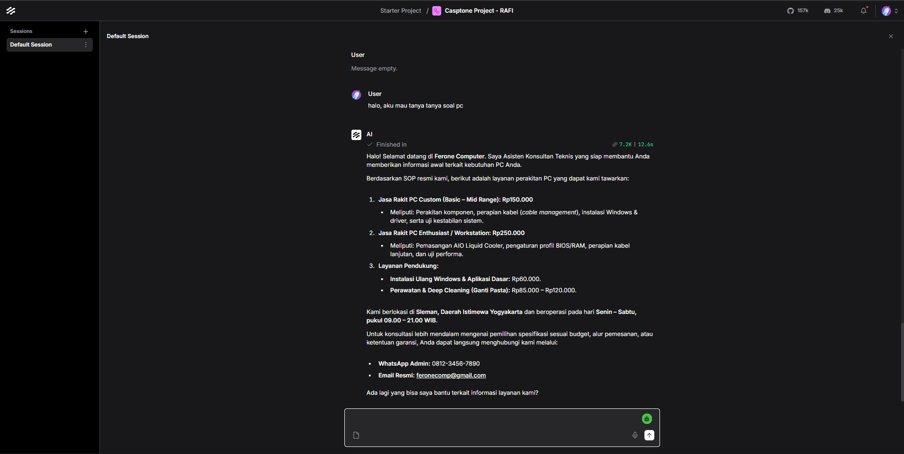

<!-- SPDX-License-Identifier: MIT -->

# Ferone Smart Assistant


**Ferone Smart Assistant** adalah asisten AI berbasis Retrieval-Augmented Generation (RAG) untuk layanan informasi dan konsultasi teknis pada perakitan PC, modding keyboard, serta IoT milik Ferone Computer.

Project ini dikembangkan sebagai Capstone Project dengan dukungan Langflow sebagai orkestrator alur, Google Gemini sebagai model bahasa dan embedding, serta DataStax Astra DB sebagai penyimpanan knowledge base berbasis pencarian semantik.

## Daftar Isi

- [Ringkasan Project](#ringkasan-project)
- [Latar Belakang](#latar-belakang)
- [Solusi yang Ditawarkan](#solusi-yang-ditawarkan)
- [Arsitektur Sistem](#arsitektur-sistem)
- [Tech Stack](#tech-stack)
- [Struktur Repositori](#struktur-repositori)
- [Tampilan Sistem](#tampilan-sistem)
- [Prasyarat](#prasyarat)
- [Instalasi](#instalasi)
- [Konfigurasi](#konfigurasi)
- [Menjalankan Flow 1: Data Ingestion](#menjalankan-flow-1-data-ingestion)
- [Menjalankan Flow 2: Retrieval & Generation](#menjalankan-flow-2-retrieval--generation)
- [Pengujian Playground](#pengujian-playground)
- [Dokumentasi Prompt](#dokumentasi-prompt)
- [Catatan Keamanan](#catatan-keamanan)
- [Author](#author)

## Ringkasan Project

Konsultasi teknis sering memerlukan referensi SOP yang konsisten, penjelasan prosedur yang tepat, serta pembatasan informasi agar tidak menimbulkan kesimpulan yang keliru. Ferone Smart Assistant membangun Knowledge Base dari dokumen SOP kemudian menjawab pertanyaan berdasarkan konteks yang relevan.

Proses sistem terdiri atas:

1. Membaca dan memecah dokumen SOP.
2. Mengubah setiap potongan teks menjadi vector embedding.
3. Menyimpan vector dan metadata ke Astra DB.
4. Mencari konteks relevan berdasarkan pertanyaan pengguna.
5. Mengirim konteks dan pertanyaan ke Google Gemini.
6. Menghasilkan jawaban berbasis dokumen yang digunakan.

## Latar Belakang

Ferone Computer menyediakan kebutuhan dan konsultasi yang berkaitan dengan:

- Perakitan dan konfigurasi PC
- Pemilihan komponen perangkat keras
- Modding keyboard
- Konsep, pengujian, dan implementasi IoT

Sumber prosedur yang hanya tersedia dalam bentuk dokumen dapat menyulitkan pencarian informasi, terutama bagi pengguna yang membutuhkan jawaban cepat dan spesifik. Selain itu, model bahasa umum berpotensi memberikan jawaban yang tidak sesuai dengan SOP internal apabila digunakan tanpa konteks dokumen.

## Solusi yang Ditawarkan

Project ini menawarkan:

- Pencarian informasi dengan pendekatan semantik
- Jawaban berbasis dokumen SOP Ferone Computer
- Pembatasan respons agar tidak di luar Knowledge Base
- Guardrail untuk mengurangi risiko halusinasi
- Alur visual dan mudah dikembangkan melalui Langflow
- Kemungkinan memperluas Knowledge Base dengan dokumen tambahan

## Arsitektur Sistem

### Diagram Overview

```text
┌─────────────────────┐
│ SOP_Ferone_Computer │
│        .pdf         │
└─────────┬───────────┘
          │
          ▼
┌─────────────────────┐
│      Read File      │
└─────────┬───────────┘
          │
          ▼
┌─────────────────────┐
│     Split Text      │
│  Chunk: 1000        │
│  Overlap: 200       │
└─────────┬───────────┘
          │
          ▼
┌─────────────────────┐
│  Google Embeddings  │
│ gemini-embedding-001│
│    3072 Dimensions  │
└─────────┬───────────┘
          │
          ▼
┌─────────────────────┐
│      Astra DB       │
│  Collection:        │
│  ferone_kb          │
└─────────────────────┘
          │
          │ Semantic retrieval
          ▼
┌─────────────────────┐
│     Chat Input      │
└─────────┬───────────┘
          │
          ▼
┌─────────────────────┐
│      Astra DB       │
│  Cosine Search      │
└─────────┬───────────┘
          │
          ▼
┌─────────────────────┐
│       Parser        │
│      Stringify      │
└─────────┬───────────┘
          │
          ▼
┌─────────────────────┐
│  3-Layer Prompt     │
│     Template        │
└─────────┬───────────┘
          │
          ▼
┌─────────────────────┐
│  Gemini 3 Flash     │
│ gemini-3-flash-     │
│      preview        │
└─────────┬───────────┘
          │
          ▼
┌─────────────────────┐
│     Chat Output     │
└─────────────────────┘
```

## Flow 1: Data Ingestion

Flow pertama bertugas membentuk Knowledge Base:

1. Komponen **Read File** membaca `SOP_Ferone_Computer.pdf`.
2. Komponen **Split Text** memecah dokumen menjadi potongan:
   - **Chunk Size:** `1000`
   - **Overlap:** `200`
3. Setiap chunk dikonversi menjadi vector melalui:
   - **Model embedding:** `models/gemini-embedding-001`
   - **Dimensi:** `3072`
4. Vector dan teks asal disimpan ke DataStax Astra DB.
5. Collection target adalah `ferone_kb`.
6. Database target adalah `db_langflow`.
7. Metric pencarian menggunakan **Cosine**.

## Flow 2: Semantic Retrieval & Generation

Flow kedua menangani pertanyaan pengguna:

1. **Chat Input** menerima pertanyaan.
2. Pertanyaan dikirim ke Astra DB sebagai search query.
3. Astra DB mencari chunk paling relevan pada `ferone_kb` menggunakan pencarian Cosine.
4. **Parser** mengubah hasil pencarian menjadi satu string/context yang dapat dimasukkan ke prompt.
5. **Prompt Template** menggabungkan:
   - Role & context
   - Task & requirements
   - Constraints & output
6. **Language Model** memproses konteks menggunakan `gemini-3-flash-preview`.
7. **Chat Output** menampilkan respons kepada pengguna.

## Tech Stack

| Komponen | Teknologi |
|---|---|
| Orchestration | Langflow |
| LLM | Google Gemini `gemini-3-flash-preview` |
| Embedding | Google `models/gemini-embedding-001` |
| Dimensi Embedding | `3072` |
| Database | DataStax Astra DB |
| Database Name | `db_langflow` |
| Collection | `ferone_kb` |
| Search Metric | Cosine |
| Pipeline | Two-Stage RAG |
| Dokumen Knowledge Base | PDF SOP Ferone Computer |

## Struktur Repositori

```text
.
├── README.md
├── assets/
│   ├── canvas.png
│   └── playground.png
├── docs/
│   ├── prompt_template.png
│   └── SOP & Katalog Layaranan Ferone Computer (1).pdf
└── flow/
    └── ferone-smart-assistant.json
```

### Keterangan Folder

- `flow/`  
  Menyimpan file export Langflow `ferone-smart-assistant.json`.

- `docs/`  
  Menyimpan SOP PDF dan dokumentasi Prompt Template.

- `assets/`  
  Menyimpan tangkapan layar Langflow Canvas dan Playground.

## Tampilan Sistem

### Langflow Canvas

Screenshot berikut merupakan tampilan rangkaian komponen Flow 1 dan Flow 2 pada Langflow.



### Langflow Playground

Screenshot berikut merupakan contoh percakapan dan hasil pengujian pada Langflow Playground.



## Prasyarat

Pastikan perangkat dan akun berikut tersedia:

- Akun Google AI Studio atau Google Cloud yang memiliki akses Google Gemini
- API Key Google Gemini
- Akun DataStax
- Astra DB database
- Langflow, baik versi desktop maupun versi cloud
- Browser modern
- Dokumen `SOP_Ferone_Computer.pdf`
- Python/lingkungan virtual jika menjalankan Langflow secara lokal

## Instalasi

### 1. Clone Repository

```bash
git clone https://github.com/<username>/ferone-smart-assistant.git
cd ferone-smart-assistant
```

Ganti `<username>` dengan nama akun GitHub yang digunakan.

### 2. Buat Environment Variable

Salin contoh konfigurasi jika tersedia:

```bash
cp .env.example .env
```

Isi variabel lingkungan di terminal atau langsung pada komponen Langflow.

```env
GOOGLE_GEMINI_API_KEY=isi_api_key_gemini
ASTRA_DB_APPLICATION_TOKEN=isi_token_astra
ASTRA_DB_API_ENDPOINT=https://...astra.datastax.com
ASTRA_DB_DATABASE= db_langflow
ASTRA_DB_COLLECTION=ferone_kb
```

> Nama variabel dapat disesuaikan dengan konfigurasi Langflow yang digunakan.

### 3. Jalankan Langflow Secara Lokal

Contoh instalasi menggunakan Python:

```bash
python -m venv .venv
source .venv/bin/activate
pip install langflow
langflow run
```

Pada Windows:

```powershell
python -m venv .venv
.venv\Scripts\Activate.ps1
pip install langflow
langflow run
```

Buka alamat lokal yang ditampilkan pada terminal, umumnya:

```text
http://localhost:7860
```

## Konfigurasi

### Konfigurasi Google Gemini

Pada komponen embedding dan Language Model:

- **LLM:** `gemini-3-flash-preview`
- **Embedding:** `models/gemini-embedding-001`
- **Dimensi:** `3072`
- Masukkan API Key Google Gemini pada komponen yang membutuhkan autentikasi.

### Konfigurasi Astra DB

Sebelum menjalankan ingestion:

1. Buat database dengan nama `db_langflow`.
2. Buat collection bernama `ferone_kb`.
3. Gunakan metric `Cosine`.
4. Pastikan collection mendukung vektor berdimensi `3072`.
5. Masukkan database ID/API endpoint dan application token pada komponen Astra DB.

Pastikan nama database, collection, dan dimensi embedding konsisten pada seluruh flow.

### Import Flow Langflow

1. Buka Langflow.
2. Pilih **New Flow** atau menu import.
3. Pilih **Import from JSON**.
4. Unggah:
   ```text
   flow/ferone-smart-assistant.json
   ```
5. Verifikasi bahwa komponen dan koneksi Flow 1 serta Flow 2 sudah terbentuk.

## Menjalankan Flow 1: Data Ingestion

1. Pastikan konfigurasi Google Gemini dan Astra DB sudah terisi.
2. Unggah `SOP_Ferone_Computer.pdf` pada komponen **Read File**.
3. Atur komponen **Split Text**:
   - **Chunk Size:** `1000`
   - **Overlap:** `200`
4. Pilih model embedding `models/gemini-embedding-001`.
5. Pastikan target Astra DB adalah:
   - **Database:** `db_langflow`
   - **Collection:** `ferone_kb`
   - **Metric:** `Cosine`
6. Jalankan Flow 1.
7. Tunggu proses ingestion selesai.
8. Periksa collection `ferone_kb` pada Astra DB untuk memastikan data telah tersimpan.

Disarankan untuk melakukan ingestion ulang apabila:

- SOP diperbarui
- Chunking berubah
- Model embedding berubah
- Collection dihapus atau dibuat ulang

## Menjalankan Flow 2: Retrieval & Generation

1. Aktifkan Flow 2 pada Langflow.
2. Pastikan komponen Astra DB menggunakan collection `ferone_kb`.
3. Pastikan **Parser** mem-format hasil pencarian menjadi string/context.
4. Masukkan Prompt Template tiga lapis pada **Prompt Template**.
5. Hubungkan hasil parser ke variabel context pada Prompt Template.
6. Hubungkan input pengguna ke variabel query.
7. Pilih model `gemini-3-flash-preview` pada **Language Model**.
8. Pastikan **Chat Output** terhubung ke output model.

## Pengujian Playground

1. Buka menu **Playground** pada Langflow.
2. Pilih Flow 2 yang telah dikonfigurasi.
3. Ajukan pertanyaan yang bersumber dari SOP, contohnya:
   - "Bagaimana prosedur perakitan PC pada Ferone Computer?"
   - "Apa yang perlu diperhatikan saat melakukan modding keyboard?"
   - "Apa langkah awal pengujian perangkat IoT?"
   - "Komponen mana yang kompatibel untuk kebutuhan pengguna?"
4. Bandingkan jawaban dengan isi SOP.
5. Uji pertanyaan di luar dokumen untuk memverifikasi bahwa sistem menyatakan informasi tidak tersedia.

### Pengujian Rekomendasi

| Skenario | Hasil yang Diharapkan |
|---|---|
| Pertanyaan tersedia pada SOP | Jawaban relevan dan berbasis konteks |
| Pertanyaan tidak tersedia | Sistem menyatakan informasi belum tersedia |
| Pertanyaan ambigu | Sistem meminta klarifikasi |
| Pertanyaan berpotensi berbahaya | Sistem menekankan keselamatan |
| Pertanyaan membutuhkan klaim teknis | Sistem tidak mengarang tanpa bukti |

## Dokumentasi Prompt

Prompt tiga lapis dan penjelasan guardrail tersedia pada:

```text
docs/prompt_template.md
```

Dokumentasi tersebut menjelaskan:

- `Role & Context`
- `Task & Requirements`
- `Constraints & Output`
- Mekanisme anti-halusinasi
- Aturan penanganan informasi yang tidak tersedia

## Catatan Keamanan

- Jangan memasukkan API Key atau Astra DB token ke dalam file JSON Langflow.
- Jangan melakukan commit file `.env`.
- Jangan menyertakan nilai asli `GOOGLE_GEMINI_API_KEY`, application token, atau credential pada README.
- Gunakan environment variable atau secret manager.
- Periksa perubahan pada repository dengan:

```bash
git status
git diff
git grep -i "api[_-]*key"
git grep -i "astra.*token"
```

- Jika credential sudah pernah ter-ekspos, segera revoke dan buat credential baru.
- Gunakan `.gitignore` untuk mencegah commit file sensitif.

## Author

**Rafi Almazzydane Fairuz Zain**  
Mahasiswa Teknik Komputer  
Universitas Amikom Yogyakarta

### Informasi Project

- Project: **Ferone Smart Assistant**
- Bidang: Retrieval-Augmented Generation
- Implementasi: Perakitan PC, Modding Keyboard, dan IoT
- Orkestrasi: Langflow
- Model: Google Gemini
- Database: DataStax Astra DB

Untuk kolaborasi, presentasi, atau pengembangan lanjutan, tambahkan informasi kontak berikut:

- GitHub: `https://github.com/raavfi`
- LinkedIn: `https://www.linkedin.com/in/rafi-almazzydane-fairuz-zain-4182ab2ba/`
- Email: `rafialmazzydane@gmail.com`

---

> Dokumen ini dapat digunakan sebagai dasar presentasi, dokumentasi teknis, laporan Capstone Project, atau portfolio GitHub.
